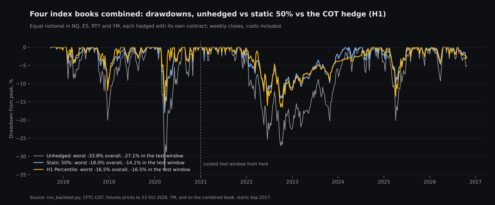

# Methodology

How the programme is built, tested and run, laid out as the seven-step Kaizen QC story: theme, situation analysis, root cause, countermeasures, implementation, before / after, standardise.

Every number here comes from `run_backtest.py` (results in `results/backtest_results.json`) or `weekly_hedge.py`.

---

## 1 Theme

Cut the drawdowns of four long index-futures books (NQ, ES, RTY, YM) by hedging each one with short futures in its own contract, sized from that market's own positioning data. The hedge should not give up more return or carry than a static hedge.

| Measure (each book, and the four combined at equal notional) | Target in the test window |
|---|---|
| Max drawdown | Shallower than static 50% |
| Return per unit of drawdown (Calmar) | Above static 50% |
| Rebalance + roll trading cost | Under 5 bp of the book a year |
| Hit rate in weeks the hedge leans away from 50% | Above 50% |

**Benchmarks:** unhedged, and a static 50% hedge in each market.

**Windows:** the rules, and which way to read each trader group, were set on NQ over 2015–20 (the fit window) and applied unchanged to ES, RTY and YM. They were then locked and scored on Jan 2021 – Oct 2026 (the test window). YM prices start 15 Sep 2017, so YM's fit window, and the combined book's, is shorter.

---

## 2 Situation analysis

### Data

**COT.** CFTC Public Reporting Environment, futures only, 8 Jan 2013 onwards (`fetch_cot.py`):
- Traders in Financial Futures (TFF, dataset `gpe5-46if`) for **asset managers**;
- Legacy (`6dca-aqww`) for **commercials**.

| Market | CFTC code | Exchange |
|---|---|---|
| NQ, E-mini Nasdaq-100 | 209742 | CME |
| ES, E-mini S&P 500 | 13874A | CME |
| RTY, E-mini Russell 2000 | 239742 (from 12 Sep 2017); 23977A before | CME; ICE mini before |
| YM, E-mini Dow ($5) | 124603 | CBOT |
| DX, US Dollar Index (context only) | 098662 | ICE |
| ZN, 10-Year T-Note (context only) | 043602 | CBOT |

RTY switches from the ICE mini to CME's E-mini on the first report where CME open interest is larger (12 Sep 2017). Every measure is a share of that venue's own open interest.

**Measures, per market and week:**
- asset managers net % OI = 100 × (AM long − AM short) / TFF open interest;
- commercials net % OI = 100 × (commercial long − commercial short) / Legacy open interest.

**Check.** After each pull, `python fetch_cot.py --check` prints the latest week in the column order of the cftc.gov weekly reports ([TFF](https://www.cftc.gov/dea/futures/financial_lf.htm), [Legacy CME](https://www.cftc.gov/dea/futures/deacmelf.htm), [CBOT](https://www.cftc.gov/dea/futures/deacbtlf.htm), [ICE](https://www.cftc.gov/dea/futures/deanybtlf.htm)). Every field should match.

**Prices (backtest only).** Daily, one contract per day, rolled at the close of the Thursday 8 days before expiry, additively back-adjusted. Not in the repo (licensed data); see [`data/prices/README.md`](data/prices/README.md).

### Timing: no look-ahead

- Positions are as of **Tuesday** and released **Friday 15:30 ET**.
- If a federal holiday falls between the as-of Tuesday and Friday, the release moves to the next business day after Friday. In 2026, Veterans Day moved it to Mon 16 Nov, Thanksgiving to Mon 30 Nov and Christmas to Mon 28 Dec.
- The 2018–19 and 2025 shutdown backlogs use the CFTC's published catch-up dates (`CATCHUP` in `hedge_lib.py`).
- The hedge is traded at the **settlement of the first trading day after the release**, normally Monday (Tuesday after a Monday release), and earns from the next day.
- When catch-up releases bunch up, only the newest report executes that day.

### Signals

For each group's net % OI, `x`:

- **52-week percentile:** the share of the trailing 52 weeks (current week included) at or below this week, scaled 0–1: `p52 = (count(window ≤ x_now) − 1) / 51`.
- **Range position (the COT index):** where this week sits in the trailing n-week range: `(x − min) / (max − min)`, clipped to 0–1. 0.5 is the range's CE (consequent encroachment, the midpoint). Computed over 52 weeks (`r52`) and 26 weeks (`r26`).

**Reading, locked from the NQ fit window:**
- commercials high = bullish;
- asset managers high = bearish (a crowded long), so they enter as 1 − x;
- **composite score = average of (commercials reading, 1 − asset-manager reading)**, for each of p52, r52 and r26. A higher score means less hedge.

### What the fit window showed

| | NQ | ES | RTY | YM |
|---|---|---|---|---|
| Correlation, AM vs commercials (net % OI) | −0.50 | 0.00 | −0.51 | −0.46 |
| Correlation, commercials vs TFF dealers | +0.79 | +0.43 | +0.71 | +0.94 |
| Fit: ρ of commercials percentile with next 13 weeks' return | +0.12 | −0.03 | +0.03 | +0.09 |
| Fit: ρ of AM percentile with next 13 weeks' return | −0.25 | −0.14 | −0.14 | −0.42 |
| Test: ρ, commercials / AM | +0.25 / −0.06 | +0.01 / +0.14 | +0.01 / −0.16 | +0.06 / −0.13 |
| Test: ρ of the composite score | +0.19 | −0.11 | +0.09 | +0.12 |

- Asset managers read best as contrarian in all four fit windows. Legacy commercials carried information only in NQ.
- In NQ, RTY and YM, commercials largely mirror the TFF dealers, who sit opposite the asset managers. In ES the two groups move independently, and the AM sign flipped in the test window, so the score has nothing stable to read there.
- Earlier work on NQ (a replication of Sanders, Boris & Manfredo, 2004) found that positions follow price. That is the warning carried into step 3.

---

## 3 Root cause: 5 whys

**Root cause, the same in all four markets: the COT score lags price and reverts, so it cuts the hedge during sell-offs.** It helped in fast crashes that started with a heavy hedge, and hurt in slower declines.

| Drawdown, peak to trough | Unhedged | Static 50% | COT hedge (H1) | H1 hedge at peak → average in the fall |
|---|---|---|---|---|
| NQ Aug–Dec 2018 | −23.7% | −12.4% | −15.2% | 75% → 44% |
| NQ Dec 2024 – Apr 2025 | −23.9% | −12.5% | −16.8% | 57% → 42% |
| ES Jan–Oct 2022 | −25.2% | −13.0% | −17.5% | 59% → 23% |
| YM Feb–Mar 2020 | −36.9% | −20.0% | −30.9% | 63% → 24% |
| YM Jan–Sep 2022 | −21.4% | −11.0% | −12.8% | 60% → 18% |
| Helped: ES Feb–Mar 2020 | −34.1% | −18.2% | −12.2% | 93% → 70% |
| Helped: RTY Aug 2018 – Mar 2020 | −43.3% | −23.5% | −13.8% | 50% → 44% |

1. **Why did the COT hedge lose more than static in most sell-offs?** It was cut while price fell: ES in 2022 went from 59% to an average of 23%.
2. **Why was it cut during a fall?** Asset managers sold as price dropped, so their percentile fell and the inverted AM term read "less crowded, so bullish". Commercials (mostly dealers) took the other side and also read bullish.
3. **Why do positions move with price?** Positions follow returns. Asset managers add after up weeks (Wald p 0.0002 in the NQ replication). A weekly snapshot mostly records a move that has already happened.
4. **Why does that hurt a hedge more than a bias read?** The hedge acts six days after the Tuesday snapshot, and the 52-week percentile moves before price finishes falling. In a crash that began with a heavy hedge the timing worked; in slower declines it didn't.
5. **Why didn't the fit window warn?** The crashes that rewarded the lag (2020, and 2015–16 in NQ) sat in the fit window beside the declines that punished it. The fit average came out strong: Calmar 0.64–0.73 against 0.42 for static on the combined book.

---

## 4 Countermeasures: the rules

Five rules run in every market, each with its own contract and its own COT score. Every rule trades at the same settlement after the release.

| Rule | Hedge ratio | Why it's in |
|---|---|---|
| **Static 50%** (the control) | 50% always | Halves exposure, carries no signal risk |
| **H1 percentile ladder** | 1 − composite p52, 0–100% | Uses the whole positioning range and averages about 50%, so it tests timing alone against static |
| **H2 12-month CE** | 25% above the CE (r52 ≥ 0.5), 75% below | Premium = buying, discount = selling, on the yearly dealing range |
| **H3 6-month quadrants** | By quadrant of r26: top 0%, Q3 33%, Q2 67%, bottom 100% | The 6-month range split into quarters |
| **H4 CE + quadrant** | Above the 12-month CE: 0 / 25 / 50 / 50%; below: 50 / 50 / 75 / 100%, top quadrant to bottom | The 12-month CE picks the side, the 6-month quadrant sets the size |

Quadrants are numbered from the bottom: Q1 = 0–25% of the range, Q4 = 75–100%.

**Execution model (`run_backtest.py`):**
- Hedge contracts = hedge ratio × book contracts, fractional in the backtest. With whole contracts on a 10-contract NQ book, H1's test max drawdown moves from −18.3% to −18.9%.
- Rebalancing costs 1 tick plus $2.25 per contract per side; a tick is $5 on NQ, RTY and YM, and $12.50 on ES. A roll costs 1 spread tick plus 2 × $2.25.
- Rolls happen at the close of the Thursday 8 days before expiry, the same day for all four markets.
- Initial margin uses the latest CME level as a share of notional (`quotes.json`), applied back in time, because no margin history was available.

**Also tested:**
- **Attribution:** H1 and H2 on commercials alone and on asset managers alone, in each market.
- **NQ only:** a ratchet that allows hedge cuts only above the 50-day average (Calmar 1.44 in the fit window, 0.28 in the test window), and ES as the hedge for the NQ book (−25.4% max drawdown against −19.0%, and about 23 bp a year less carry).

---

## 5 Implementation: the weekly cycle and the rolls

Each week has one decision in each market, and all four trade on the same day since one CFTC release covers them.

1. Positions as of Tuesday.
2. CFTC release Friday 15:30 ET (next business day in a holiday week).
3. Pull and check the data: `python fetch_cot.py`, then compare the `--check` output with cftc.gov.
4. Update `quotes.json` with Monday's (or the trade day's) front and next-quarter settlements and the CME margins.
5. `python weekly_hedge.py`: score each market, print the hedge for every rule and the contracts per 10-contract book.
6. Trade each hedge to its new size at the next settlement.

**Roll carry.** At each roll the hedge sells the dearer next contract, so for a short hedge the roll is a credit. It cancels the book's own roll on the hedged share, so it is neither a cost nor a gain to the hedged book. The spread-implied carry is `r − q = ln(F_next / F_front) / τ`, with τ the years between the two expiries.

**Variation margin.** The hedge pays out in rallies. The worst 21 days in the backtest cost the static hedge 11–12.5% of each book (7.6–14.2% for H1). If the books are held somewhere else (CFDs at another broker, for example), those gains don't offset the futures account. Keep about 12% of each hedged book in cash at the futures broker, on top of initial margin.

---

## 6 Before / after

**Static 50% cut the combined book's worst drawdown by 48%; the COT rules cut it by 35–41%.** None beat static by more than chance would in any market.

**Locked test window, Jan 2021 – Oct 2026: max drawdown (Calmar), costs included**

| Book | Unhedged | Static 50% | H1 percentile | H2 12-month CE | H3 6-month quadrants | H4 CE + quadrant |
|---|---|---|---|---|---|---|
| NQ | −36.2% (0.32) | −19.0% (0.33) | −18.3% (0.35) | −22.0% (0.31) | −22.4% (0.31) | −23.5% (0.30) |
| ES | −25.2% (0.41) | −13.0% (0.41) | −19.5% (0.12) | −17.4% (0.18) | −18.8% (0.14) | −19.8% (0.12) |
| RTY | −35.1% (0.10) | −18.3% (0.13) | −22.2% (0.17) | −19.0% (0.19) | −25.3% (0.16) | −25.1% (0.17) |
| YM | −21.4% (0.35) | −11.0% (0.36) | −15.0% (0.32) | −12.7% (0.33) | −15.9% (0.40) | −16.1% (0.32) |
| Four combined | −27.1% (0.31) | −14.1% (0.32) | −16.5% (0.27) | −16.0% (0.29) | −17.3% (0.30) | −17.7% (0.28) |

- **Average hedge:** 50% for static; 46–60% for the COT rules.
- **Fit window** (2015–20; YM and the combined book from Sep 2017), static Calmar against the COT rules: NQ 0.69 vs 0.82–0.94, ES 0.32 vs 0.40–0.55, RTY 0.22 vs 0.31–0.47, YM 0.29 vs 0.14–0.27, combined 0.42 vs 0.64–0.73. The edge in the fit window did not carry over.

**Is it more than chance? No.** Each weekly hedge path was shifted in time against the returns about 250 times (circular shifts of at least 26 weeks), which keeps the path's persistence and breaks its timing. Test-window Calmar p-values: NQ 0.30–0.42, ES 0.85–0.90, RTY 0.16–0.28, YM 0.31–0.60. None is below 0.05.

**Hit rate by regime, H1, test window.** A hit is a week where leaning away from 50% beat static.

| | NQ | ES | RTY | YM |
|---|---|---|---|---|
| Premium, above the 12-month CE: hit (market up-weeks) | 57.7% (58.9%) | 51.9% (55.6%) | 58.2% (56.6%) | 53.0% (52.1%) |
| Discount, below the CE: hit (market up-weeks) | 48.0% (56.7%) | 40.2% (58.8%) | 49.3% (47.6%) | 47.8% (55.9%) |
| All lean weeks: hit (95% Wilson CI) | 52.0% (46–58) | 44.4% (39–50) | 54.0% (48–60) | 49.8% (44–55) |
| Against static, bp per week (Newey-West t) | +0.5 (0.1) | −5.2 (−1.3) | +3.3 (0.7) | +1.8 (0.6) |

The "selling" regime didn't deliver falling markets: markets rose in 48–59% of discount weeks, so the heavy hedge lost about as often as it won. The premium regime's hit rate is mostly each market's normal upward drift.

**Attribution: the 12-month CE rule on one group, test window, max drawdown (Calmar)**

| | NQ | ES | RTY | YM |
|---|---|---|---|---|
| Commercials alone | −28.8% (0.21) | −15.3% (0.32) | −17.4% (0.12) | −12.7% (0.42) |
| Asset managers alone | −18.3% (0.48) | −17.4% (0.20) | −20.1% (0.28) | −13.0% (0.24) |

No single group wins across markets: commercials alone was best on YM and worst on NQ.

**Roll cost, 2015–26, static 50%**

| | NQ | ES | RTY | YM |
|---|---|---|---|---|
| Roll trading cost, bp of book per year | 1.1 | 2.0 | 2.3 | 1.2 |
| Roll carry earned by the hedge, bp per year | 87 | 48 | 50 | 59 |
| Average spread-implied r − q | 1.73% | 0.95% | 0.99% | 1.19% |

Initial margin averaged 3.2–4.3% of each book for the static hedge.

---

## 7 Standardise

**Standard: hedge each book with its own contract and keep 50% as the anchor in all four markets.** Run the COT ladder (H1) as a tracked experiment beside a static-50% shadow in each market, not as a proven edge. Leave ES on static.

### Weekly SOP

- [ ] Friday 15:30 ET, or the next business day in a holiday week: `python fetch_cot.py`; check `--check` against the cftc.gov weekly reports.
- [ ] Update `quotes.json` (front / next settlements, CME initial and maintenance margins).
- [ ] `python weekly_hedge.py`; contracts = round(hedge × book contracts) in each market.
- [ ] Trade the differences in the front contracts at the next settlement.
- [ ] Log, for each market: as-of date, release date, hedge, contracts, fill against settlement, and the static-50% shadow P&L.
- [ ] Optional: `python chart_rules.py`, `python chart_ranges.py`, `python chart_dx_zn.py` for the dealing-range charts.

### At each roll (Thursday, 8 days before expiry; all four together)

- [ ] Roll each hedge with a calendar-spread order.
- [ ] Log the spreads and implied r − q, and re-mark the next roll's carry.
- [ ] Hold initial margin plus about 12% of each hedged book at the futures broker; top up when cash falls under initial margin plus 5%.

### Review (PDCA check: monthly, and at each roll)

- In each market and on the combined book, compare H1 with the static shadow on drawdown, Calmar, and the hit rate in lean weeks.
- **Set the stop rule before the data comes in.** A suggested, untested trigger: go back to static 50% in a market if, after 26 weeks, H1 trails static by more than 3 points of drawdown, or its lean-week hit rate is under 45%.
- Each December, rerun `run_backtest.py` with the new year added.

### What not to do

- **Don't tilt the ES hedge off COT.** Out of sample every rule did worse than static: −17% to −20% max drawdown against −13%, shift-test p 0.85–0.90.
- **Don't hedge one index with another.** ES as the hedge for NQ left a −25% max drawdown against −19%, and earned less carry.
- **Don't size off commercials alone.** It was the best group on YM and the worst on NQ (−28.8%), so it isn't a standard that holds across markets.
- **Don't add rules fitted to the latest episode.** On NQ the ratchet's Calmar went from 1.44 in the fit window to 0.28 in the test window.
- **Never act on Tuesday's positions before the release.**

---

## Cross-asset context: Dollar Index and 10-Year Note

`chart_dx_zn.py` draws the same 12 / 6 / 3-month dealing ranges for DX and ZN commercials. They show where positioning sits; DX and ZN were not part of the hedge backtest, and the quadrant ladder on them is an illustration, not a tested rule. The same holds for the quadrants on 12 and 3 months in the index charts: only H2 (the 12-month CE split) and H3 (6-month quadrants) were backtested.

---

## Assumptions and limits

- **The books** are long futures positions at constant notional, rolled on the hedge's schedule. Real trade P&L would differ. The combined book is 25% in each market, rebalanced daily.
- **Margins** are today's CME levels as a share of notional, applied back in time.
- **Costs** are fixed per contract (see step 4); slippage in fast markets would be larger.
- **Coverage:** YM starts 15 Sep 2017; RTY's COT before 12 Sep 2017 is the ICE mini.
- **Data revisions:** the CFTC occasionally revises past weeks. `fetch_cot.py` re-pulls the full history each time.
- This is a backtest of rules, not financial advice.

## Sources

- [CFTC Public Reporting Environment](https://publicreporting.cftc.gov): TFF (`gpe5-46if`) and Legacy (`6dca-aqww`), futures only.
- CFTC weekly reports: [TFF](https://www.cftc.gov/dea/futures/financial_lf.htm), [Legacy CME](https://www.cftc.gov/dea/futures/deacmelf.htm), [Historical Viewable index](https://www.cftc.gov/MarketReports/CommitmentsofTraders/HistoricalViewable/index.htm).
- Release timing: [CFTC Release 7864-19](https://www.cftc.gov/PressRoom/PressReleases/7864-19) (2019 catch-up), [CFTC accelerated COT schedule, Nov 2025](https://mondovisione.com/news/cftc-to-accelerate-publication-of-backlogged-cot-data-2025129), [CFTC 2026 release schedule](https://www.cftc.gov/zh-hans/node/132401).
- Sanders, D. R., Boris, K. & Manfredo, M. (2004). Hedgers, funds, and small speculators in the energy futures markets: an analysis of the CFTC's Commitments of Traders reports. *Energy Economics*, 26(3), 425–445.
