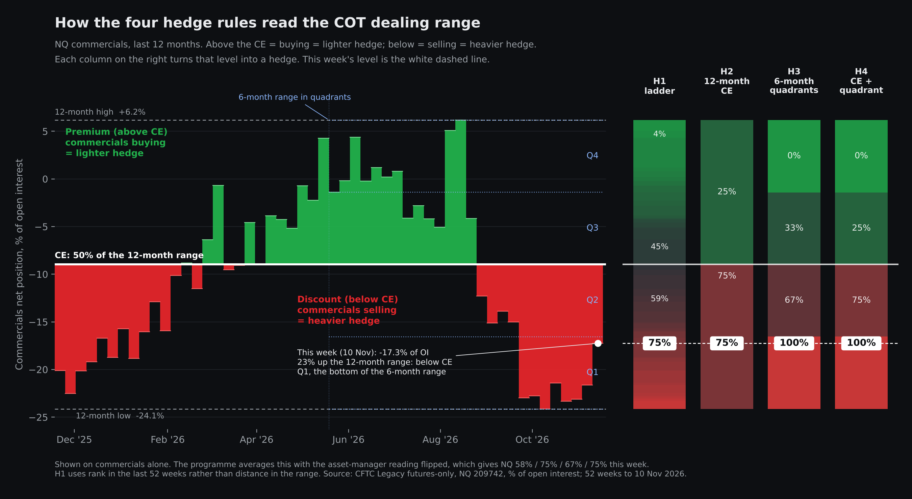
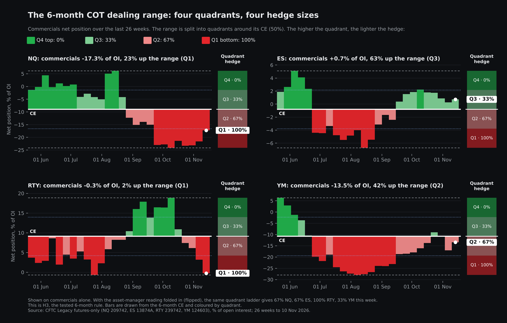
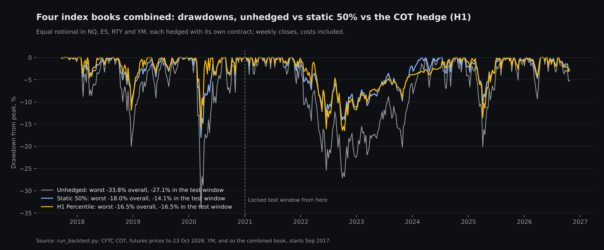

# COT Hedging Programme

**Weekly short-futures hedges for long NQ, ES, RTY and YM books, sized from CFTC Commitments of Traders positioning (asset managers and Legacy commercials) and read through 12-month and 6-month dealing ranges. Backtested 2015–2026, with a locked out-of-sample test.**

**The result first: no COT-sized hedge beat a static 50% hedge out of sample (Jan 2021 – Oct 2026) in any of the four markets.** On the four books combined, static 50% held the worst drawdown to −14.1% (unhedged −27.1%); the COT rules ran −16.0% to −17.7% at similar average hedges. The standard is therefore a static 50% hedge in each market, with the COT ladder (H1) tracked beside it as an experiment.



## The rules

Each market gets a composite score from its own COT data: the average of the commercials reading and the asset-manager reading flipped (commercials high = bullish, asset managers high = crowded = bearish). The score then sizes the hedge:

| Rule | Hedge |
|---|---|
| Static 50% | 50% always (the control) |
| H1 percentile ladder | 1 − the score's 52-week percentile |
| H2 12-month CE | 25% above the 12-month range's CE, 75% below |
| H3 6-month quadrants | Top quadrant 0%, Q3 33%, Q2 67%, bottom 100% |
| H4 CE + quadrant | The 12-month CE picks the side, the 6-month quadrant the size |



## Results, locked test window (Jan 2021 – Oct 2026)

Max drawdown (Calmar), costs included:

| Book | Unhedged | Static 50% | H1 | H2 | H3 | H4 |
|---|---|---|---|---|---|---|
| NQ | −36.2% (0.32) | −19.0% (0.33) | −18.3% (0.35) | −22.0% (0.31) | −22.4% (0.31) | −23.5% (0.30) |
| ES | −25.2% (0.41) | −13.0% (0.41) | −19.5% (0.12) | −17.4% (0.18) | −18.8% (0.14) | −19.8% (0.12) |
| RTY | −35.1% (0.10) | −18.3% (0.13) | −22.2% (0.17) | −19.0% (0.19) | −25.3% (0.16) | −25.1% (0.17) |
| YM | −21.4% (0.35) | −11.0% (0.36) | −15.0% (0.32) | −12.7% (0.33) | −15.9% (0.40) | −16.1% (0.32) |
| Four combined | −27.1% (0.31) | −14.1% (0.32) | −16.5% (0.27) | −16.0% (0.29) | −17.3% (0.30) | −17.7% (0.28) |

A circular-shift test of each hedge path gave test-window Calmar p-values of 0.16–0.90; none is below 0.05. In the fit years the same rules looked far better (Calmar 0.64–0.73 against 0.42 on the combined book). The root cause: positions follow price, so the score cuts the hedge during sell-offs. [METHODOLOGY.md](METHODOLOGY.md) has the full story, laid out as the seven Kaizen steps.



## Run it each week

```bash
pip install -r requirements.txt
python fetch_cot.py          # pull TFF + Legacy from the CFTC, then print the latest week for the cftc.gov cross-check
# edit quotes.json: front / next-quarter settlements and CME margins
python weekly_hedge.py       # this week's hedge per market and rule, quadrants, roll carry, margins
python chart_rules.py; python chart_ranges.py; python chart_dx_zn.py   # optional: the dealing-range charts
```

COT positions are as of Tuesday and released Friday 15:30 ET (the next business day in a holiday week). The hedge trades at the settlement of the first trading day after the release.

To rebuild the backtest, add the price files described in [`data/prices/README.md`](data/prices/README.md), then run `python run_backtest.py` and `python chart_drawdowns.py`.

## Files

| Path | What it is |
|---|---|
| `METHODOLOGY.md` | The full method: data, timing, signals, rules, backtest design, results, weekly SOP |
| `config.py` | Paths, CFTC codes, contract specs |
| `quotes.json` | Latest settlements and CME margins (update weekly) |
| `fetch_cot.py` | Pulls the COT data from the CFTC Public Reporting Environment; `--check` prints the cross-check |
| `hedge_lib.py` | Release calendar, signals, the hedge rules, rolls, metrics |
| `weekly_hedge.py` | This week's hedge; writes `results/this_week.json` and `results/roll_schedule.csv` |
| `run_backtest.py` | Four-market backtest; writes `results/backtest_results.json` and the weekly series |
| `chart_*.py` | The charts in `charts/` |
| `data/cot/` | CFTC TFF and Legacy futures-only data, Jan 2013 onwards (public domain) |
| `results/` | Backtest results, roll history, this week's hedge |

## Sources

- [CFTC Public Reporting Environment](https://publicreporting.cftc.gov): TFF (`gpe5-46if`) and Legacy (`6dca-aqww`), futures only.
- CFTC weekly reports for the cross-check: [TFF](https://www.cftc.gov/dea/futures/financial_lf.htm), [Legacy CME](https://www.cftc.gov/dea/futures/deacmelf.htm).

## Disclaimer

A backtest of hedge-sizing rules for research and education. Not financial advice. Futures are leveraged and can lose more than the margin posted.
